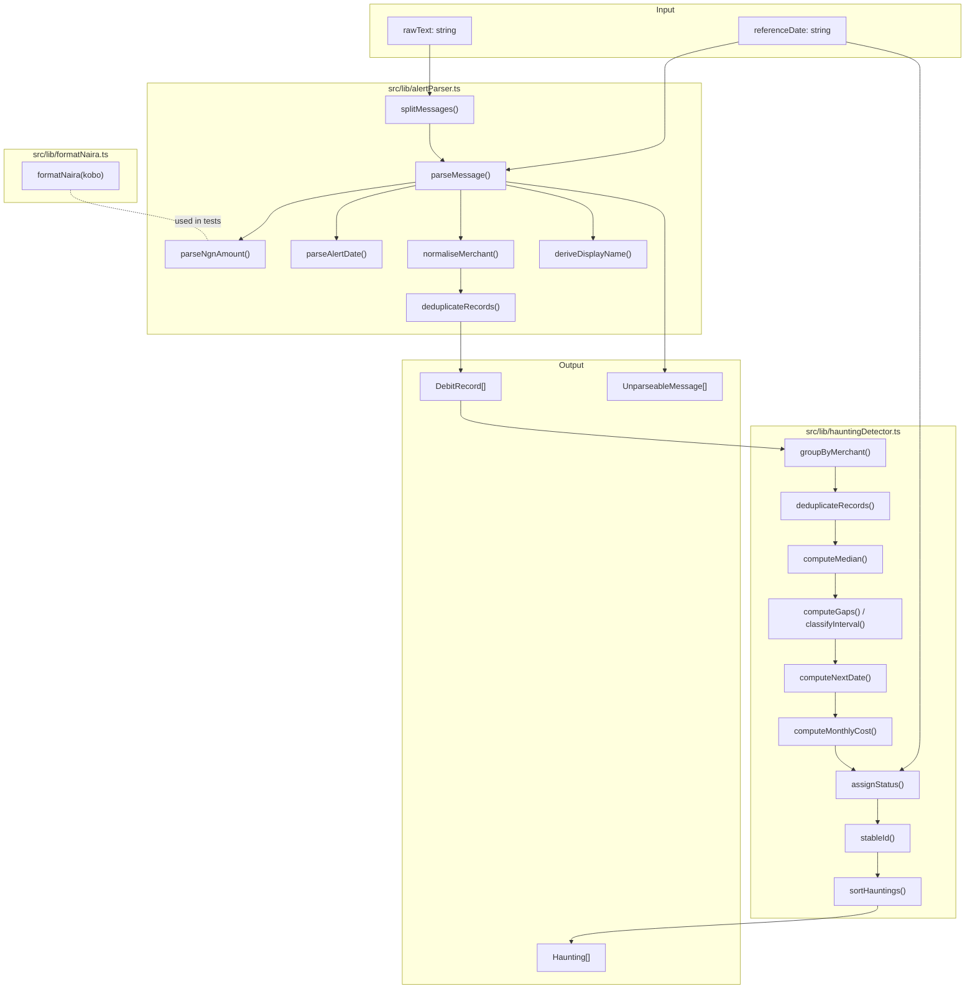

# Design Document

## Overview

Graveyard Core Logic is two pure TypeScript modules — `alertParser` and `hauntingDetector` — plus the `formatNaira` helper, all living under `src/lib`. Nothing in this layer imports React, Next.js, or any browser API. Every function is deterministic given its inputs, and the Reference_Date parameter is threaded explicitly so both modules remain fully testable.

The Alert Parser accepts raw text (one or more bank debit-alert messages pasted as a single string) and a Reference_Date string. It splits the text into individual Alert_Messages, extracts a structured Debit_Record from each one that it can parse, and collects any that it cannot into an Unparseable_Messages list. The Haunting Detector receives the array of Debit_Records and the same Reference_Date, groups records by Normalised_Merchant, identifies merchants with three or more charges that recur at a consistent interval, and returns a sorted array of Haunting objects.

All monetary values travel through the system as integers in kobo (1 naira = 100 kobo). Floating-point arithmetic is never used for money; naira and kobo parts are parsed separately and combined with integer multiplication and addition.

---

## Supported Alert Formats

The Alert Parser recognises three made-up alert layouts. For each format, field extraction is attempted only after the debit/credit check described below.

### Debit vs credit detection

Before attempting any field extraction, `parseMessage` inspects the full message text (case-insensitive):

- A message is a **debit alert** if it contains any of: `"debited"`, `"Debit Alert"`, `"Account Debit"` (case-insensitive match for each phrase).
- A message is a **credit alert** if it contains any of: `"credited"`, `"Credit Alert"` (case-insensitive).
- The bare words `"debit"` and `"credit"` alone do NOT match — so "debit card" does not trigger debit detection.
- If a message matches **both** the debit patterns and the credit patterns, add it to Unparseable_Messages with reason `"ambiguous alert type"`. Do not silently exclude it.
- If a message matches **neither**, add it to Unparseable_Messages with reason `"unrecognised format"`.

This check runs before any regex extraction so that partial matches cannot accidentally parse a credit as a debit.

---

### Format A — Labelled fields (key: value on separate lines)

Each line is trimmed of leading and trailing whitespace before any label regex is applied.

```
Debit Alert
Amt: NGN 4,500.00
Desc: ZapTunes Monthly
Date: 15/03/2024
Acct: ****1234
Bal: NGN 55,000.00
```

**Extraction rules:**

- Amount: the line starting with `Amt:` (case-insensitive). Regex: `^Amt:\s*(.+)$` — linear-time, no nested quantifiers.
- Merchant: the line starting with `Desc:`. Regex: `^Desc:\s*(.+)$`.
- Date: the line starting with `Date:`. Regex: `^Date:\s*(.+)$`.
- `Acct:` and `Bal:` lines are ignored entirely and never stored.

---

### Format B — One-line narrative

```
Your account was debited NGN 1,200.00 for NeonBites Delivery on 07/04/2024. Ref: TRF-00042.
```

**Extraction rules:**

Regex: `debited\s+((?:NGN|₦)\s?[\d,]+(?:\.\d{1,2})?)\s+for\s+(.+?)\s+on\s+([\d/\-A-Za-z]+)`

Explanation:
- Group 1 (amount): `(?:NGN|₦)\s?[\d,]+(?:\.\d{1,2})?` — accepts `NGN` or `₦`, an optional single space, digits and commas, and an optional decimal part of 1–2 digits. Covers `NGN 1,200.00`, `₦750`, `NGN1200.5`.
- Group 2 (merchant): non-greedy, bounded on the right by the literal `\s+on\s+` — this prevents catastrophic backtracking because the right boundary is a fixed literal, not another variable-length pattern.
- Group 3 (date): `[\d/\-A-Za-z]+` — accepts digits, slashes, hyphens, and letters, so `07/04/2024`, `15-Mar-2024`, and `2024-03-15` all match. No nested quantifiers; linear-time.

Note that the regex does not anchor to start-of-line; it searches within the full message text.

- The trailing `Ref:` token is not captured; `normaliseMerchant` will strip it anyway.

---

### Format C — Email-style (Subject + body)

Each line is trimmed of leading and trailing whitespace before any label regex is applied. This applies to `Amount:`, `Description:`, and `Value Date:` lines.

```
Transaction Alert - Account Debit
Amount: ₦750.00
Description: GhostRide Ltd REF20240315
Value Date: 15-Mar-2024
```

**Extraction rules:**

- Amount: the line starting with `Amount:`. Regex: `^Amount:\s*(.+)$`.
- Merchant: the line starting with `Description:`. Regex: `^Description:\s*(.+)$`. The ref token (`REF20240315`) is stripped by `normaliseMerchant`'s ref-style token removal.
- Date: the line starting with `Value Date:`. Regex: `^Value Date:\s*(.+)$`.

---

## Architecture



The pipeline is strictly unidirectional. Each stage is a small, independently testable pure function. No stage mutates its input.

---

## Components and Interfaces

### `src/lib/formatNaira.ts`

Single exported function:

```ts
export function formatNaira(kobo: number): string
```

Accepts an integer kobo value, returns a string in the form `"NGN X,XXX.XX"`. Used by the app UI and in parser round-trip tests.

---

### `src/lib/alertParser.ts`

Exported entry point:

```ts
export function parseAlerts(
  rawText: string,
  referenceDate: string
): { records: DebitRecord[]; unparseable: UnparseableMessage[] }
```

Internal helper functions (not exported, but individually unit-tested via named exports in test-only re-export):

| Function | Signature | Responsibility |
|---|---|---|
| `splitMessages` | `(raw: string) → string[]` | Splits raw text on blank lines or alert-header patterns; preserves 1-based line offset per segment |
| `parseMessage` | `(msg: string, lineOffset: number, refDate: string) → DebitRecord \| UnparseableMessage` | Attempts to parse a single Alert_Message; returns a record or an unparseable entry |
| `parseNgnAmount` | `(text: string) → AmountResult` | Extracts an NGN/₦ amount and returns `{ ok: true, kobo }` using integer arithmetic; returns `{ ok: false, reason: "unsupported currency" }` for non-NGN currencies; returns `{ ok: false, reason: "invalid amount" }` when numeric parts cannot be parsed |
| `parseAlertDate` | `(text: string, refDate: string) → string \| null \| "invalid" \| "missing"` | Parses dates in DD/MM/YYYY, DD-Mon-YYYY, YYYY-MM-DD, and DD/MM formats; resolves year for DD/MM using refDate; returns ISO-8601 string or sentinel |
| `normaliseMerchant` | `(raw: string) → string` | Lowercase; remove all-digit tokens; remove ref-style tokens (letters immediately followed by digits); strip punctuation; collapse whitespace; trim. If result is empty, caller adds to Unparseable_Messages with reason `"missing merchant"` |
| `deriveDisplayName` | `(raw: string) → string` | Remove all-digit tokens and ref-style tokens, then truncate to 60 characters |
| `deduplicateRecords` | `(records: DebitRecord[]) → DebitRecord[]` | Removes duplicate records sharing the same (normalised merchant, date, amount) triple |

**Message splitting strategy**

A blank line is defined as a line containing zero non-whitespace characters. The splitter also recognises alert-header patterns (lines starting with common bank alert prefixes such as "Debit Alert", "Account Debit", "Transaction Alert"). In addition, any line containing the Format B debit narrative pattern — the word `"debited"` followed by an NGN/₦ amount — is treated as a self-contained message boundary, so multiple one-line Format B alerts pasted consecutively without blank lines are each split into their own message. Segments are trimmed of leading/trailing whitespace before passing to `parseMessage`.

**Amount parsing: integer arithmetic only**

`parseNgnAmount` returns an `AmountResult` discriminated union — never a bare `number | null`:

```ts
type AmountResult = { ok: true; kobo: number } | { ok: false; reason: string };
```

The function never calls `parseFloat` on the full currency string. The algorithm:

1. Strip `NGN`, `₦`, and all commas.
2. If the original string contains a non-NGN currency symbol or code, return `{ ok: false, reason: "unsupported currency" }`.
3. Split on `.` to get `nairaStr` and `koboStr`.
4. Validate `nairaStr` against `/^\d+$/` — return `{ ok: false, reason: "invalid amount" }` if it does not match.
5. Validate `koboStr` (if present) against `/^\d{1,2}$/` — return `{ ok: false, reason: "invalid amount" }` if it does not match.
6. Compute: `kobo = parseInt(nairaStr, 10) * 100 + parseInt((koboStr ?? "0").padEnd(2, "0").slice(0, 2), 10)`.
7. If computed `kobo > Number.MAX_SAFE_INTEGER`, return `{ ok: false, reason: "invalid amount" }`.
8. Otherwise return `{ ok: true, kobo }`.

Callers check `.ok` before using `.kobo`. `parseNgnAmount` does **not** call `roundHalfUp`.

**Merchant normalisation**

```
normaliseMerchant(raw):
  1. Lowercase
  2. Remove all-digit tokens (tokens that are entirely numeric, e.g. "12345")
  3. Remove ref-style tokens (tokens where letters are immediately followed by digits, e.g. "ref123", "TRF20240315", "REF-00042")
  4. Strip all punctuation (keep alphanumeric and single spaces)
  5. Collapse multiple spaces to one
  6. Trim
```

If the result is an empty string after all steps, `parseMessage` shall add the message to Unparseable_Messages with reason `"missing merchant"`.

**Display_Name derivation**

```
deriveDisplayName(raw):
  1. Remove all-digit tokens (tokens that are entirely numeric)
  2. Remove ref-style tokens (letters immediately followed by digits)
  3. Trim
  4. Truncate to 60 characters
```

---

### `src/lib/hauntingDetector.ts`

Exported entry point:

```ts
export function detectHauntings(
  records: DebitRecord[],
  referenceDate: string
): Haunting[]
```

Internal helper functions:

| Function | Signature | Responsibility |
|---|---|---|
| `groupByMerchant` | `(records: DebitRecord[]) → Map<string, DebitRecord[]>` | Groups records by `normalisedMerchant` |
| `deduplicateRecords` | `(records: DebitRecord[]) → DebitRecord[]` | Same triple-key dedup as in parser; ensures detector is safe even if caller skipped dedup |
| `computeMedian` | `(amounts: number[]) → number` | Median of a sorted number array; even-length arrays use average of two middle values, rounded half-up |
| `filterByTolerance` | `(records: DebitRecord[], median: number) → DebitRecord[]` | Returns records whose amount is within ±10% of the median |
| `computeGaps` | `(sortedDates: string[]) → number[]` | Returns array of day-gaps between consecutive ISO-8601 date strings |
| `classifyInterval` | `(gaps: number[]) → Interval \| null` | Returns `"weekly"`, `"monthly"`, or `"yearly"` if every gap falls within the respective range; otherwise null |
| `computeNextDate` | `(lastDate: string, interval: Interval) → string` | Adds 7, ~30, or ~365 days with month-end clamping and leap-year handling |
| `computeMonthlyCost` | `(typicalAmount: number, interval: Interval) → number` | Applies round-half-up formula per interval |
| `assignStatus` | `(nextDate: string, interval: Interval, refDate: string) → HauntingStatus` | Compares nextDate to refDate + one full interval period |
| `stableId` | `(normalisedMerchant: string, interval: Interval) → string` | Deterministic slug: `${normalisedMerchant}-${interval}` with spaces replaced by hyphens |
| `sortHauntings` | `(hauntings: Haunting[]) → Haunting[]` | Sort by `estimatedMonthlyCost` descending, then `id` ascending |

**Date arithmetic rules**

All date arithmetic uses integer day numbers computed with `Date.UTC(year, month, day)` — never local time, never `new Date(isoString)` without UTC. This ensures results are identical in all time zones.

- **Weekly**: next date = lastChargeDate + 7 days (integer addition on UTC day numbers).
- **Monthly**: next date = same day of month + 1 calendar month, with month-end clamping. Example: Jan 31 + 1 month = Feb 28 (or Feb 29 in a leap year). Never overflow into the next month.
- **Yearly**: next date = same day + 1 calendar year, with leap-year clamping. Example: Feb 29 + 1 year (non-leap target) = Feb 28.
- **Status "lapsed"**: a haunting is lapsed when `referenceDate > nextExpectedDate + one full interval period` (all comparisons in UTC day numbers). Active otherwise.

---

**Determinism**

To ensure the output of `detectHauntings` is fully deterministic regardless of input order:

- `sourceCharges` within each haunting are sorted by date ascending, then by amount ascending (secondary sort), before being stored. This guarantees a stable order that does not depend on the order records appear in the input.
- `Haunting.displayName` is taken from the most recent charge in the merchant group (the charge with the latest date). If two charges share the same most-recent date, choose the one whose `displayName` is alphabetically first (lexicographic ascending).
- `chargeCount` is the count of `sourceCharges` **after** de-duplication, not the count of raw input records for that merchant.

**Round-half-up helper**

```ts
function roundHalfUp(n: number): number {
  return Math.floor(n + 0.5);
}
```

Used by `computeMedian` (even-length average) and `computeMonthlyCost`.

**Stable ID**

The id is a plain string slug, not a cryptographic hash, because the input space is small and collisions are extremely unlikely in practice:

```
stableId("netflix", "monthly") → "netflix-monthly"
stableId("uber eats nigeria", "weekly") → "uber-eats-nigeria-weekly"
```

This keeps the id human-readable and avoids a hashing dependency. If two different merchants normalise to the same string — an edge case the requirements do not need to handle — the ids will collide; this is acceptable given the stated requirements.

---

### `src/lib/index.ts`

Re-exports `parseAlerts`, `detectHauntings`, and `formatNaira` as the public API of the lib layer.

---

## Data Models

```ts
// src/lib/types.ts

export type Interval = "weekly" | "monthly" | "yearly";
export type HauntingStatus = "active" | "lapsed";

/** Discriminated union returned by parseNgnAmount. */
export type AmountResult =
  | { ok: true; kobo: number }
  | { ok: false; reason: string };

/** Structured output from the Alert Parser for one successfully parsed debit. */
export interface DebitRecord {
  /** Integer kobo. Never a float. */
  amount: number;
  /** ISO-8601 date string, e.g. "2024-03-15". */
  date: string;
  /** Lowercase, whitespace-collapsed, punctuation-stripped, digit-run-removed merchant string. */
  normalisedMerchant: string;
  /** Original merchant text with all-digit tokens and ref-style tokens removed, truncated to 60 chars. */
  displayName: string;
}

/** An Alert_Message the parser could not fully convert to a DebitRecord. */
export interface UnparseableMessage {
  /** 1-based line number where this Alert_Message starts in the original rawText. */
  lineNumber: number;
  /** Human-readable explanation, e.g. "missing date", "unsupported currency", "invalid date". */
  reason: string;
  /** The raw text of the Alert_Message, for display purposes. */
  rawText: string;
}

/** A recurring charge pattern identified by the Haunting Detector. */
export interface Haunting {
  /** Deterministic slug: normalisedMerchant + "-" + interval. */
  id: string;
  normalisedMerchant: string;
  displayName: string;
  /** Median kobo amount of qualifying charges (within ±10% tolerance). */
  typicalAmount: number;
  interval: Interval;
  /** ISO-8601 date of the most recent charge in this merchant group. */
  lastChargeDate: string;
  /** ISO-8601 date the next charge is expected. */
  nextExpectedDate: string;
  /** Estimated cost per month in kobo, computed with round-half-up arithmetic. */
  estimatedMonthlyCost: number;
  /** Total number of Debit_Records in the merchant group, including out-of-tolerance records. */
  chargeCount: number;
  /** All Debit_Records in the merchant group, including out-of-tolerance records. */
  sourceCharges: DebitRecord[];
  status: HauntingStatus;
}

/** Return type of parseAlerts. */
export interface ParseResult {
  records: DebitRecord[];
  unparseable: UnparseableMessage[];
}
```

---

## Correctness Properties

*A property is a characteristic or behavior that should hold true across all valid executions of a system — essentially, a formal statement about what the system should do. Properties serve as the bridge between human-readable specifications and machine-verifiable correctness guarantees.*

### Property 1: formatNaira / parseNgnAmount round-trip

*For any* valid NGN currency string (naira part 0–9,999,999, kobo part 00–99), parsing the string to an integer kobo value and then formatting that value with `formatNaira` and parsing again SHALL produce the same kobo value.

**Validates: Requirements 2.4**

---

### Property 2: Parser never throws

*For any* string (including empty strings, whitespace-only strings, strings with non-printable characters, and very long strings) and any valid ISO-8601 date string as the Reference_Date, calling `parseAlerts` SHALL return a `ParseResult` object without throwing an exception.

**Validates: Requirements 1.16**

---

### Property 3: Haunting detection requires ≥3 qualifying charges

*For any* set of Debit_Records where either (a) every merchant group has fewer than 3 records total, or (b) every merchant group has 3 or more records but all amounts are more than ±10% apart from each other (no 3 form a consistent cluster), `detectHauntings` SHALL return an empty array.

Arbitrary hint: generate merchant groups with 1–2 records, OR generate 3+ records where amounts span a range larger than 20% of the smallest value.

**Validates: Requirements 3.3**

---

### Property 4: Haunting detection is order-independent

*For any* array of Debit_Records and any Reference_Date, shuffling the input array before calling `detectHauntings` SHALL produce a result with the same set of hauntings (same ids, same values) as the unshuffled call.

**Validates: Requirements 4.1**

---

### Property 5: Deduplication is idempotent

*For any* array of Debit_Records, calling `detectHauntings` on the array and calling `detectHauntings` on the array with every record duplicated (each record appearing twice) SHALL produce the same set of hauntings.

**Validates: Requirements 3.2**

---

### Property 6: Generated monthly series yields exactly one haunting

*For any* generated series of 3–12 Debit_Records for a single fictional merchant where all amounts are identical and all consecutive date gaps are between 28 and 31 days, `detectHauntings` SHALL return exactly one haunting with `interval: "monthly"`.

Arbitrary: `fc.integer({ min: 3, max: 12 })` for charge count; `fc.integer({ min: 1, max: 100_000_000 })` for a single fixed amount; generate dates by starting from a fixed base date and adding `fc.integer({ min: 28, max: 31 })` days successively.

**Validates: Requirements 3.5**

---

### Property 7: Output is sorted correctly

*For any* array of Debit_Records, the returned hauntings array satisfies: for every adjacent pair `[a, b]`, either `a.estimatedMonthlyCost > b.estimatedMonthlyCost`, or (`a.estimatedMonthlyCost === b.estimatedMonthlyCost` and `a.id <= b.id`).

**Validates: Requirements 4.2**

---

### Property 8: chargeCount equals sourceCharges.length

*For any* array of Debit_Records, every Haunting in the result satisfies `haunting.chargeCount === haunting.sourceCharges.length`.

**Validates: Requirements 3.15, 3.16**

---

### Property 9: Every haunting has ≥3 charges within tolerance

*For any* array of Debit_Records, every Haunting satisfies: filtering `sourceCharges` to those whose amount is within ±10% of `typicalAmount` yields at least 3 records.

**Validates: Requirements 3.3, 3.8**

---

## Input Validation and Limitations

**Maximum input length**: `parseAlerts` checks `rawText.length` before any processing. If `rawText.length > 200_000`, it returns immediately with `{ records: [], unparseable: [{ lineNumber: 1, reason: "input too large", rawText: "" }] }`. It does not process the string at all.

**Regex safety**: all regexes used in parsing must be linear-time — no nested quantifiers, no alternation with shared prefixes that could cause catastrophic backtracking. The regexes documented in the "Supported Alert Formats" section above satisfy this constraint. Any new regex added during implementation must be reviewed against this rule before merging.

**referenceDate validation**: both `parseAlerts` and `detectHauntings` validate that `referenceDate` is a valid ISO-8601 date string (`YYYY-MM-DD`, real calendar date). If the string does not match the pattern or represents an impossible date (e.g. `2024-02-30`), `parseAlerts` returns `{ records: [], unparseable: [{ lineNumber: 1, reason: "invalid reference date", rawText: "" }] }` and `detectHauntings` returns `[]`. The reason `"invalid reference date"` is distinct from all other unparseable reasons to make it easy to identify at the call site.

**Known limitation — blank line inside an alert**: The splitter treats any blank line as a message boundary. If a bank alert contains a blank line in its body (e.g. between subject and body in an email format), the splitter will treat it as two separate messages, and both halves will likely be unparseable. This is a known limitation; no workaround is provided.

---

## Error Handling

**Parser**

- The top-level `parseAlerts` function wraps the full pipeline in a try/catch. Any unexpected exception is caught and results in the offending segment being added to `unparseable` with reason `"internal error"`. This guarantees requirement 1.16 (never throws) even in the presence of unanticipated input.
- Each `parseMessage` call is isolated: an error in one message does not affect subsequent messages.
- Non-NGN currencies produce an `UnparseableMessage` with reason `"unsupported currency"` — they are never silently dropped.
- Credit alerts are silently excluded (no Debit_Record, no Unparseable_Message entry).

**Haunting Detector**

- `detectHauntings` is a pure function over already-validated data. It does not need a catch-all because its inputs (DebitRecord arrays) are already typed. Individual per-merchant processing is wrapped so a malformed date in one group cannot poison other groups.
- Merchant groups that do not reach the 3-charge threshold, or whose gaps are inconsistent, are silently excluded from the output — this is correct per requirements 3.3 and 3.17.

**Amount arithmetic**

- `parseNgnAmount` validates that `nairaStr` matches `/^\d+$/` and that `koboStr` (when present) matches `/^\d{1,2}$/` before computing the kobo value. Any input failing those checks returns `{ ok: false, reason: "invalid amount" }`. After computing the integer result, if it exceeds `Number.MAX_SAFE_INTEGER` the function also returns `{ ok: false, reason: "invalid amount" }`. Non-NGN currencies return `{ ok: false, reason: "unsupported currency" }`. In both failure cases the message goes to `unparseable` with the corresponding reason.

---

## Testing Strategy

### File layout

```
src/lib/
  formatNaira.ts
  formatNaira.test.ts
  alertParser.ts
  alertParser.test.ts
  alertParser.property.test.ts
  hauntingDetector.ts
  hauntingDetector.test.ts
  hauntingDetector.property.test.ts
  types.ts
  index.ts
```

### Unit tests (Vitest)

**`formatNaira.test.ts`**
- Zero kobo → `"NGN 0.00"`
- Exact naira, no kobo → `"NGN 1,500.00"` for 150000
- Naira with kobo → `"NGN 1,234.56"` for 123456
- Large value with multiple comma groups

**`alertParser.test.ts`**
- Single well-formed NGN alert → one DebitRecord
- Multiple alerts separated by blank lines → correct count
- Non-NGN currency → one UnparseableMessage with reason `"unsupported currency"`
- DD/MM date with year resolution (future → previous year)
- Impossible date (month 13) → `"invalid date"`
- No date field → `"missing date"`
- Credit alert → excluded from both arrays
- Empty / whitespace-only input → empty arrays
- Duplicate records → deduplicated to one
- Display_Name: 6+ digit run removed, truncated at 60 chars
- Leading/trailing whitespace on lines → no parse error

**`hauntingDetector.test.ts`**
- Fewer than 3 qualifying charges → no haunting
- 3 monthly charges → one haunting with correct typicalAmount, nextExpectedDate, status
- January 31 monthly → next date is Feb 28/29
- Feb 29 yearly → next date is Feb 28 in non-leap year
- Weekly interval classification
- Yearly interval classification
- Out-of-tolerance charges included in chargeCount/sourceCharges, excluded from median
- Lapsed status when overdue by more than one interval
- Output sorted by estimatedMonthlyCost desc, then id asc
- stableId is deterministic: same merchant + interval → same id
- Inconsistent gaps → no haunting

### Property-based tests (fast-check)

The project already declares `fast-check ^4.11.0` as a devDependency. Each property test is configured with at least 100 runs (fast-check default is 100; set explicitly with `{ numRuns: 100 }`).

**`formatNaira.property.test.ts` / `alertParser.property.test.ts`**

**Property 1 — formatNaira round-trip**

```
// Feature: graveyard-core-logic, Property 1: formatNaira/parseNgnAmount round-trip
fc.assert(
  fc.property(
    fc.integer({ min: 0, max: 999_999_999 }),  // kobo values up to ~10M naira
    (kobo) => {
      const formatted = formatNaira(kobo);
      const result = parseNgnAmount(formatted);
      return result.ok && result.kobo === kobo;
    }
  ),
  { numRuns: 100 }
);
```

Arbitrary: `fc.integer({ min: 0, max: 999_999_999 })` — covers zero, single-naira, large values with comma groups.

**Property 2 — Parser never throws**

```
// Feature: graveyard-core-logic, Property 2: Parser never throws
fc.assert(
  fc.property(
    fc.string(),
    fc.date({ min: new Date("2000-01-01"), max: new Date("2099-12-31") })
      .map(d => d.toISOString().slice(0, 10)),
    (rawText, referenceDate) => {
      let result: unknown;
      try {
        result = parseAlerts(rawText, referenceDate);
      } catch {
        return false;
      }
      return (
        result !== null &&
        typeof result === "object" &&
        Array.isArray((result as ParseResult).records) &&
        Array.isArray((result as ParseResult).unparseable)
      );
    }
  ),
  { numRuns: 100 }
);
```

Arbitrary: `fc.string()` for rawText (covers empty, whitespace, non-printable, very long), plus a date-shaped string for referenceDate.

**`hauntingDetector.property.test.ts`**

**Property 3 — Haunting requires ≥3 qualifying charges**

```
// Feature: graveyard-core-logic, Property 3: Haunting detection requires at least 3 qualifying charges
```

Arbitrary: build a `fc.array(debitRecordArbitrary)` where each merchant group is constrained to 1 or 2 records. Assert the result is `[]`.

The `debitRecordArbitrary` generates:
- `amount`: `fc.integer({ min: 1, max: 100_000_000 })`
- `date`: ISO-8601 string from `fc.date({ min, max }).map(...)`
- `normalisedMerchant`: `fc.stringMatching(/^[a-z][a-z ]{1,20}$/)` to ensure clean grouping
- `displayName`: `fc.string({ maxLength: 60 })`

**Property 4 — Shuffle invariance**

```
// Feature: graveyard-core-logic, Property 4: Haunting detection is order-independent
```

Arbitrary: `fc.array(debitRecordArbitrary, { minLength: 0, maxLength: 30 })` plus a shuffle permutation via `fc.shuffledSubarray` or a Fisher-Yates shuffle applied inside the property. Assert that `detectHauntings(shuffled, refDate)` produces the same ids and values as `detectHauntings(original, refDate)`.

**Property 5 — Deduplication idempotence**

```
// Feature: graveyard-core-logic, Property 5: Deduplication is idempotent
```

Arbitrary: same `debitRecordArbitrary` array. Duplicate every record (concat the array with itself). Assert that `detectHauntings(doubled, refDate)` returns the same hauntings as `detectHauntings(original, refDate)`.

**Property 6 — Generated monthly series yields exactly one haunting**

```
// Feature: graveyard-core-logic, Property 6: Generated monthly series yields exactly one haunting
```

Arbitrary: `fc.integer({ min: 3, max: 12 })` for charge count; `fc.integer({ min: 1, max: 100_000_000 })` for a single fixed amount in kobo; dates generated by starting from a fixed base date and adding `fc.integer({ min: 28, max: 31 })` days successively; a single fictional merchant name. Assert that `detectHauntings` returns exactly one haunting with `interval === "monthly"`.

**Property 7 — Output is sorted correctly**

```
// Feature: graveyard-core-logic, Property 7: Output is sorted correctly
```

Arbitrary: `fc.array(debitRecordArbitrary, { minLength: 0, maxLength: 30 })`. Assert that for every adjacent pair `[a, b]` in the result, either `a.estimatedMonthlyCost > b.estimatedMonthlyCost`, or (`a.estimatedMonthlyCost === b.estimatedMonthlyCost` and `a.id <= b.id`).

**Property 8 — chargeCount equals sourceCharges.length**

```
// Feature: graveyard-core-logic, Property 8: chargeCount equals sourceCharges.length
```

Arbitrary: `fc.array(debitRecordArbitrary, { minLength: 0, maxLength: 30 })`. Assert that every haunting in the result satisfies `haunting.chargeCount === haunting.sourceCharges.length`.

**Property 9 — Every haunting has ≥3 charges within tolerance**

```
// Feature: graveyard-core-logic, Property 9: Every haunting has at least 3 charges within tolerance
```

Arbitrary: `fc.array(debitRecordArbitrary, { minLength: 0, maxLength: 30 })`. Assert that for every haunting in the result, filtering `sourceCharges` to those whose amount is within ±10% of `typicalAmount` yields at least 3 records.

### Test data constraints (Requirement 5)

All test fixtures use:
- Fictional bank names: "FableBank", "MythicBank PLC"
- Fictional merchants: "ZapTunes", "NeonBites Delivery", "GhostRide Ltd"
- Invented references: "TRF/2024/00001", "REF-999XYZ"
- No real Nigerian bank alert formats, no real account numbers, no real personal names
